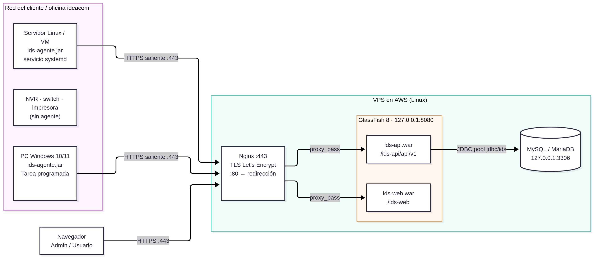

# ideacom IDS — Infrastructure & Device Status

[](https://app.travis-ci.com/AL07075185/ideacom-ids)

Sistema ligero de monitoreo de disponibilidad de dispositivos para **ideacom**. Un agente instalado en cada equipo reporta su estado a una API REST en la nube, que detecta desconexiones, apagados y pérdidas de internet, guarda el historial y calcula la disponibilidad. Un panel web permite al área de soporte consultar el estado, aprobar equipos, ver el mapa de red y gestionar incidencias.

> Proyecto integrador del certificado **Desarrollo de proyectos con Java** (Universidad Tecmilenio), Taller de productividad basada en herramientas tecnológicas.
> Este es el **repositorio académico**: contiene la versión 1 (MVP) autorizada por ideacom para su evaluación. El producto es propiedad de ideacom y su evolución continúa en un repositorio privado de la empresa.

## Tabla de contenidos

1. [Problema](#problema)
2. [Solución](#solución)
3. [Arquitectura](#arquitectura)
4. [Estructura del repositorio](#estructura-del-repositorio)
5. [Requisitos](#requisitos)
6. [Compilar y ejecutar las pruebas](#compilar-y-ejecutar-las-pruebas)
7. [Instalación y configuración](docs/INSTALACION.md)
8. [API REST y reglas de estado](docs/api-y-reglas.md)
9. [Modelo de datos](docs/modelo-datos.md)
10. [Flujo de trabajo: ramas, issues y milestones](#flujo-de-trabajo)
11. [Cómo contribuir](CONTRIBUTING.md)
12. [Roadmap](docs/roadmap.md)
13. [Licencia](#licencia)

## Problema

El área de Soporte y Servicios de TI de ideacom se entera de las fallas cuando el cliente llama, lleva el inventario en hojas de cálculo y no tiene historial ni métricas de disponibilidad de los equipos que atiende.

## Solución

| Componente | Módulo | Función |
|---|---|---|
| Agente | `ids-agente` (JAR) | Registra el equipo con su inventario y envía un latido cada 60 s; guarda eventos si pierde comunicación. |
| API REST | `ids-api` (WAR) | Recibe reportes, aplica la máquina de estados, detecta desconexiones cada 30 s y calcula la disponibilidad. |
| Panel web | `ids-web` (WAR) | Dashboard, dispositivos, mapa de red, incidencias y administración por rol. |
| Común | `ids-common` (JAR) | Reglas de estado, cálculo de disponibilidad y DTO compartidos. |

## Arquitectura

Microservicios desplegables por separado que se comunican por REST/JSON: Java 21, Jakarta EE 11 sobre GlassFish 8, MySQL/MariaDB y Nginx con HTTPS en un VPS de AWS.



## Estructura del repositorio

```
├── ids-common/   reglas de negocio y DTO compartidos
├── ids-api/      API REST (JAX-RS, JPA, CDI, EJB timer) y reporte JSP
├── ids-web/      panel web (HTML, JavaScript, Bootstrap)
├── ids-agente/   agente de monitoreo (Java sin dependencias)
├── db/           esquema, datos iniciales y migraciones
├── deploy/       GlassFish, Nginx e instaladores del agente
└── docs/         documentación y diagramas
```

## Requisitos

- JDK 21 (Eclipse Temurin u OpenJDK)
- Maven 3.9 o superior
- Eclipse GlassFish 8.0
- MySQL 8.0 o MariaDB 10.6+
- Nginx (solo producción)

## Compilar y ejecutar las pruebas

```bash
git clone git@github.com:AL07075185/ideacom-ids.git
cd ideacom-ids
mvn -B clean verify        # compila los módulos y ejecuta las pruebas JUnit 5
```

Las mismas pruebas se ejecutan en [Travis CI](https://app.travis-ci.com/AL07075185/ideacom-ids) en cada push y pull request.

## Flujo de trabajo

- `master`: versiones liberadas, marcadas con tags (`v1.1.0-beta`, `v1.1.0-rc.1`, `v1.1.0`).
- `develop`: integración diaria; rama por defecto.
- `feature/...` y `fix/...`: una rama por issue, integrada a `develop` mediante pull request con Travis CI en verde.
- Cada requerimiento de la especificación es un **issue** con descripción, análisis y solución, etiquetado por elemento y prioridad.
- **Milestones:** Beta (26/11/2026), RC (30/11/2026), GA (01/12/2026) y Roadmap (fuera de la versión 1).
- Tablero Kanban en **Zube** sincronizado con los issues.

## Autor

AL07075185 — Universidad Tecmilenio, 2026.

## Licencia

© 2026 ideacom. Todos los derechos reservados. El código se publica con fines académicos y de evaluación; no se otorga licencia de uso, copia ni distribución sin autorización de ideacom. Consulta el archivo [LICENSE](LICENSE).
