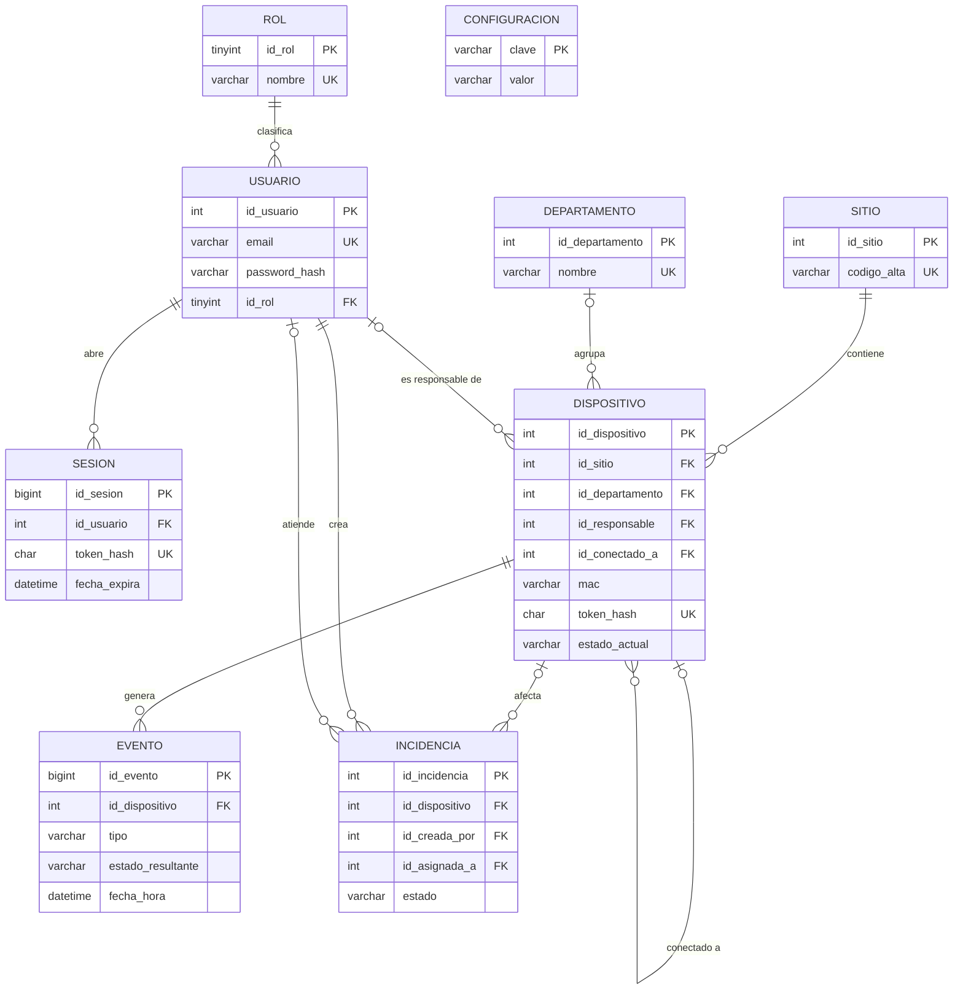

# Modelo de datos — ideacom IDS

Base de datos `ideacom_ids` (MySQL 8.0 / MariaDB), 9 tablas normalizadas a **3FN**.
Todas las fechas se guardan en **UTC** con precisión de milisegundos (`DATETIME(3)`).

## Diagrama entidad-relación

## Normalización

### Punto de partida (sin normalizar)
Una hoja de cálculo típica de inventario tendría una fila por equipo con columnas como:
`Equipo | Sitio y dirección | Departamento | Responsable y correo | Hardware ("Win 11, i5, 16 GB") | Caídas ("12/11 10:02; 13/11 08:40") | Incidencias`

### Primera forma normal (1FN): valores atómicos, sin grupos repetidos
- El hardware se separa en columnas atómicas: `so_nombre`, `so_version`, `arquitectura`, `cpu_modelo`, `ram_mb`, `disco_gb`.
- Las caídas e incidencias son grupos repetidos: salen a sus propias tablas, `evento` e `incidencia`, con una fila por ocurrencia.
- Cada tabla tiene llave primaria (`id_*`, autoincremental).

### Segunda forma normal (2FN): sin dependencias parciales
- Todas las tablas usan una llave primaria simple (surrogada), así que no puede haber dependencias de una parte de la llave.
- La llave natural del dispositivo es compuesta (`id_sitio`, `mac`) y se conserva como `UNIQUE`. Ningún atributo depende solo del sitio o solo de la MAC: los datos del sitio viven en `sitio`.

### Tercera forma normal (3FN): sin dependencias transitivas
- `dispositivo` guarda `id_departamento`, `id_responsable` e `id_sitio`, no sus nombres. El nombre del departamento depende del departamento, no del dispositivo.
- `usuario` guarda `id_rol`; el nombre y la descripción del rol viven en `rol`.
- `incidencia` no copia la IP ni el nombre del equipo; los obtiene por `id_dispositivo`.
- Los parámetros del sistema (intervalo del latido, umbral, duración de sesión) no se repiten en cada dispositivo: viven en `configuracion`.

### Decisiones de diseño documentadas
- **Estado instantáneo en `dispositivo`** (`estado_actual`, `ultimo_latido`, `internet_ok`): describen al dispositivo en este momento y dependen solo de su llave, por lo que se respeta 3FN. El historial completo está en `evento`.
- **Los latidos no se guardan como filas.** Con 50 equipos y un latido por minuto serían 72,000 filas al día. Solo se guarda `ultimo_latido` y se registra un `evento` cuando el estado **cambia**.
- **Conjuntos cerrados como `VARCHAR` + `CHECK`** (`tipo`, `estado_*`, `prioridad`, `origen`): son valores que define el código (enums de Java), no el usuario. Los conjuntos que edita el administrador o que tienen atributos propios (`departamento`, `rol`) son tablas catálogo.
- **Tokens guardados como hash SHA-256** (`token_hash`): si alguien obtiene la base de datos, no puede suplantar agentes ni sesiones.

## Diccionario de datos (resumen)

| Tabla | Campo | Tipo | Nulo | Descripción |
|---|---|---|---|---|
| rol | id_rol | TINYINT | No | PK |
| rol | nombre | VARCHAR(30) | No | ADMIN, USUARIO (único) |
| usuario | id_usuario | INT | No | PK |
| usuario | email | VARCHAR(150) | No | Correo de acceso (único) |
| usuario | password_hash | VARCHAR(200) | No | PBKDF2-SHA256, 210,000 iteraciones, con sal |
| usuario | id_rol | TINYINT | No | FK → rol |
| usuario | activo | BOOLEAN | No | Permite desactivar sin borrar |
| sesion | token_hash | CHAR(64) | No | SHA-256 del token Bearer del panel (único) |
| sesion | fecha_expira | DATETIME(3) | No | Fin de la sesión (UTC) |
| sitio | codigo_alta | VARCHAR(40) | No | Código que usa el agente para registrarse (único) |
| departamento | nombre | VARCHAR(80) | No | Único |
| dispositivo | id_sitio | INT | No | FK → sitio |
| dispositivo | id_departamento | INT | Sí | FK → departamento |
| dispositivo | id_responsable | INT | Sí | FK → usuario |
| dispositivo | id_conectado_a | INT | Sí | FK → dispositivo (para el mapa) |
| dispositivo | nombre | VARCHAR(100) | No | Etiqueta visible, editable |
| dispositivo | tipo | VARCHAR(20) | No | PC, SERVIDOR, RED, CAMARA, NVR, IMPRESORA, OTRO |
| dispositivo | con_agente | BOOLEAN | No | Falso para equipos agregados a mano (switch, router) |
| dispositivo | ipv6 | VARCHAR(45) | Sí | IPv6 global de la interfaz que usa el agente |
| dispositivo | mac | VARCHAR(17) | Sí | Única por sitio |
| dispositivo | token_hash | CHAR(64) | Sí | SHA-256 del token del agente |
| dispositivo | estado_registro | VARCHAR(15) | No | PENDIENTE, APROBADO, RECHAZADO |
| dispositivo | estado_actual | VARCHAR(20) | No | EN_LINEA, SIN_INTERNET, APAGADO, DESCONECTADO, SIN_AGENTE, DESCONOCIDO |
| dispositivo | ultimo_latido | DATETIME(3) | Sí | Último reporte recibido (UTC) |
| evento | tipo | VARCHAR(30) | No | REGISTRO, ARRANQUE, APAGADO, RECONEXION, DESCONEXION_INESPERADA, SIN_INTERNET, INTERNET_RESTABLECIDO, SIN_CONEXION_SERVIDOR, CAMBIO_IP, APROBADO, RECHAZADO |
| evento | estado_resultante | VARCHAR(20) | Sí | Estado al que llevó el evento (base del cálculo de disponibilidad) |
| evento | origen | VARCHAR(10) | No | AGENTE, SERVIDOR, PANEL |
| evento | fecha_fin | DATETIME(3) | Sí | Solo para periodos (p. ej. sin conexión de X a Y) |
| incidencia | prioridad | VARCHAR(10) | No | BAJA, MEDIA, ALTA |
| incidencia | estado | VARCHAR(15) | No | ABIERTA, EN_PROCESO, CERRADA |
| configuracion | clave | VARCHAR(60) | No | PK (p. ej. `latido.intervalo.segundos`) |

## Clases principales (paquete `mx.ideacom.ids`)

| Capa | Clases |
|---|---|
| Modelo compartido (`common`) | `EstadoDispositivo`, `TipoEvento`, `EstadoRegistro`, DTO del agente (records), `ReglasEstado`, `DisponibilidadCalculadora`, `Fechas` |
| Entidades JPA (`api.entidad`) | `Rol`, `Usuario`, `Sesion`, `Sitio`, `Departamento`, `Dispositivo`, `Evento`, `Incidencia`, `Configuracion` |
| Repositorios (`api.repositorio`) | Uno por agregado: `DispositivoRepositorio`, `EventoRepositorio`, `UsuarioRepositorio`, etc. |
| Servicios (`api.servicio`) | `AgenteServicio`, `AuthServicio`, `DispositivoServicio`, `IncidenciaServicio`, `CatalogoServicio`, `DashboardServicio`, `DetectorDesconexiones` |
| Controladores REST (`api.recurso`) | `AuthRecurso`, `AgenteRecurso`, `DispositivoRecurso`, `IncidenciaRecurso`, `CatalogoRecurso`, `DashboardRecurso` |
| Seguridad (`api.seguridad`) | `FiltroAutenticacion`, `PasswordHasher`, `Tokens`, `Sujeto`, `Acceso` |
| Agente (`agente`) | `AgenteMain`, `Agente`, `ConfigAgente`, `Recolector`, `RevisorInternet`, `ClienteApi`, `BufferEventos`, `EstadoLocal` |
